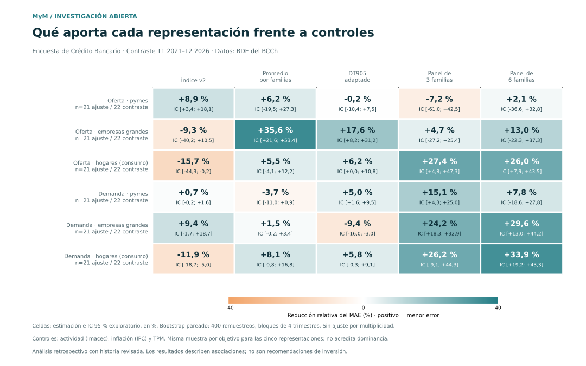
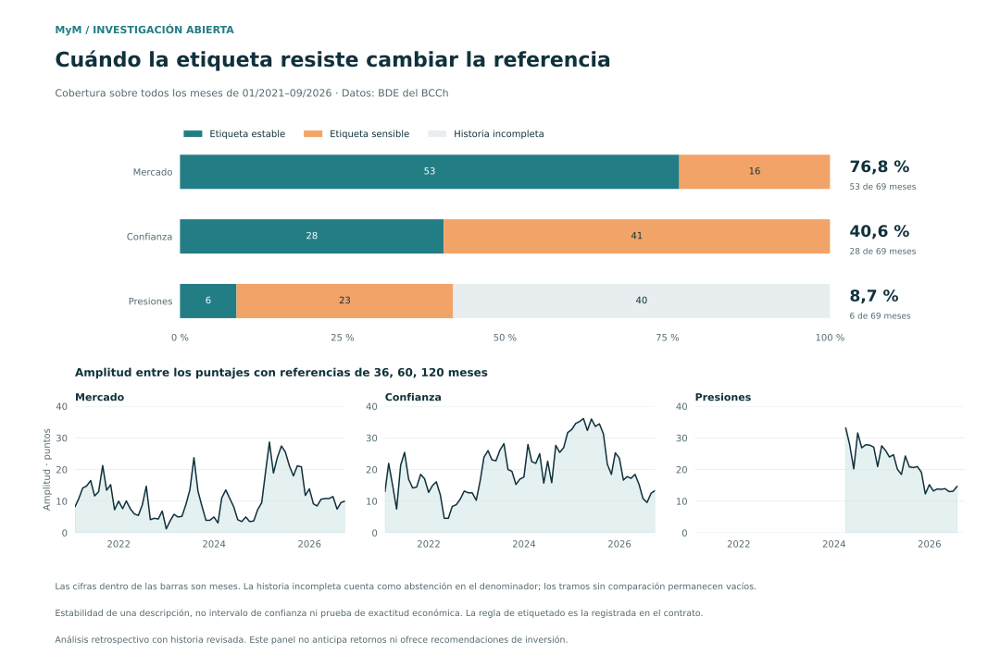
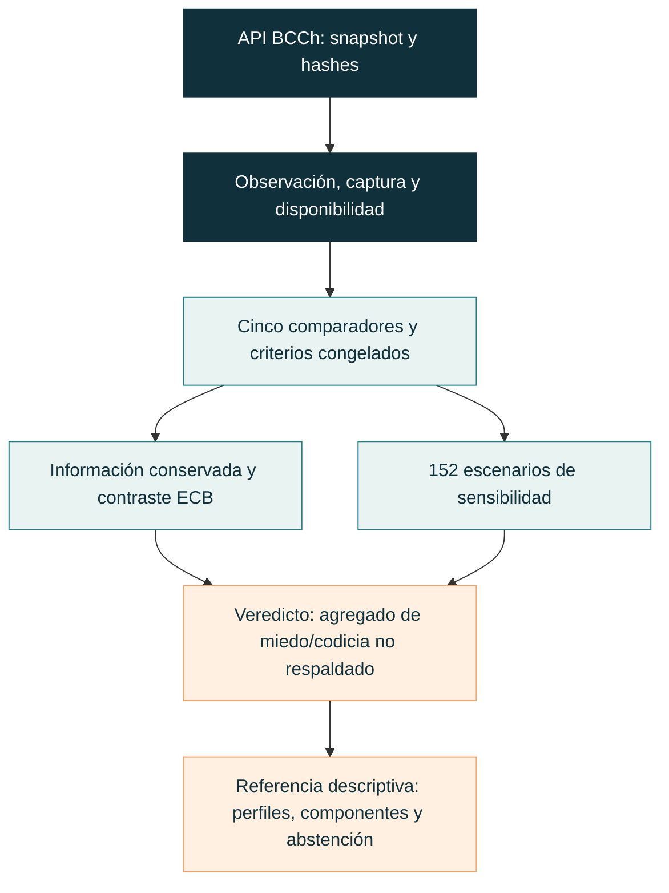

# Diagnóstico financiero de Chile

**Herramienta gratuita de [MyM Ingenierías](https://mymingenierias.com), con datos exclusivamente de la API del Banco Central de Chile.**

Un promedio puede ocultar diferencias relevantes: precios que avanzan con confianza débil,
o crédito con respuestas opuestas entre bancos. Este repositorio permite examinar qué
cambió, en qué componentes y con qué respaldo. Incluye datos de referencia, cálculos,
figuras y una campaña reproducible de evaluación.

**Resultado del cierre metodológico: B — no respaldado para un índice agregado de
miedo/codicia ni para un diagnóstico generalmente estable en un único titular.**
Se conserva la referencia descriptiva de seis perfiles, con rangos y abstenciones.
No se presenta como medición de emociones, indicador validado de apetito por riesgo,
recomendación de inversión ni pronóstico financiero.

[Veredicto y cifras](docs/cierre-veredicto.md) · [Matriz de afirmaciones](docs/cierre-matriz.md) ·
[Qué mide cada componente](docs/cierre-definiciones.md) · [Reproducir](#reproducir-la-campaña)

## Qué permite consultar

| Perfil | Pregunta que ayuda a examinar | Límite de interpretación |
|---|---|---|
| Mercado | ¿Cómo cambiaron el momentum y la valoración bursátil? | Precios altos no identifican codicia |
| Confianza | ¿Cómo se ubican las respuestas de hogares y empresas respecto de su historia? | Confianza declarada no equivale a preferencia por riesgo |
| Presiones e incertidumbre | ¿Qué ocurrió con spreads, fondeo, variabilidad de tasas e IDIE? | Son mecanismos diferentes; no identifican una causa común |
| Participación | ¿Cómo cambió la rotación bursátil? | Mayor actividad puede acompañar alzas o caídas |
| Crédito real | ¿Cómo evolucionaron las colocaciones comerciales descontando el IPC? | Mezcla oferta, demanda y composición |
| Composición monetaria | ¿Qué proporción de M2 corresponde a M1? | No identifica por sí sola una preferencia por seguridad |

Los tres primeros perfiles forman la lectura central; los tres últimos aportan contexto.
Cada puntaje permite consultar su transformación, componentes y pesos. Las encuestas
trimestrales de crédito conservan su frecuencia y muestran sus respuestas desagregadas.
El archivo de metodología identifica las reglas y los límites: [referencia congelada](campaign/results/methodology.json).

## Qué pasó al ponerlo a prueba

Se compararon cinco arquitecturas, nueve ablaciones económicas y **152 escenarios de
sensibilidad**, con criterios principales fijados antes del primer lote. El control
de simplificación se registró después de conocer resultados agregados y se declara como
corrección posterior. Todos los investigadores conocían la exploración anterior:
se trata de contraste retrospectivo.

- Los agregados recuperaron entre **58,8% y 73,5%** de las categorías de los perfiles,
  por debajo del mínimo de 90%. Mostrar los componentes conserva esa información;
  no crea información nueva ni valida su significado económico.
- Cambiar moderadamente los pesos produjo diferencias acotadas. Cambiar horizonte
  histórico o retrasar datos produjo cambios de interpretación mucho mayores.
- La asociación con seis medidas de crédito reservadas mostró aportes distintos según
  objetivo y periodo. No hubo un ganador uniforme.
- SINDy no superó el control previo de tamaño de muestra e identificación; no se ajustó.
- Una simplificación a cinco perfiles parecía cumplir el margen de 5% al mirar todo el
  contraste. Al separar selección 2021–2022 y comprobación 2023–2026 dejó de cumplirlo.
  Se conserva el panel completo como referencia, sin forzar un ganador validado.



*Reducción de error frente a controles de ciclo, inflación y política monetaria.
Intervalos exploratorios; 21 trimestres de ajuste y 22 de contraste. No es una prueba de emociones.*

## Cuándo la herramienta se abstiene

Una etiqueta firme exige acuerdo entre referencias de 36, 60 y 120 meses, con una
amplitud máxima de 20 puntos. Si falta historia o cambia la lectura entre horizontes,
se conserva el dato y se informa la sensibilidad; no se fuerza una etiqueta.



La etiqueta cumplió esa regla en **53 de 69 meses para mercado, 28 para confianza y 6
para presiones**. Esto impide promocionar un titular estable general. Los rangos son
escenarios de referencia, no intervalos probabilísticos de confianza.

## Reproducir la campaña

Requisitos: Python 3.11+ y Git. Desde la raíz del repositorio:

```bash
python -m venv .venv
```

Activa el entorno con `.\.venv\Scripts\Activate.ps1` en PowerShell o
`source .venv/bin/activate` en macOS/Linux. Luego:

```bash
python -m pip install -e ".[dev]"
python -m campaign.reproduce --output outputs/closure-run
python -m campaign.reproduce --output outputs/closure-replay --compare-to outputs/closure-run
python -m pytest
```

El pipeline verifica los hashes de las **52 series y 91.144 filas del snapshot BCCh**,
calcula transformaciones y comparadores, ejecuta los experimentos y produce informe,
matriz, metodología, trazabilidad y figuras. La segunda ejecución compara los resultados.
El snapshot incluido permite reproducir esta campaña sin credenciales ni consultas nuevas.

La referencia original permanece identificada por el commit
`7dfcedbad4a08fd0b4d51f4ea57df1997d69fed5`. El protocolo, sus correcciones y los resultados
negativos se conservan; no se eliminan variantes por haber funcionado peor.

## Consultar la API y registrar capturas nuevas

Copia `.env.example` a `.env` y completa localmente `BCCH_API_KEY`. El entorno del proceso
tiene prioridad. La plantilla no contiene valores reales y Git excluye los secretos.
Nunca pegues el token en código, comandos, logs o incidencias.

```bash
python -m research.collect --salida outputs/captura-nueva --fin 2026-10-29
python -m research.analyze --datos outputs/captura-nueva --salida outputs/analisis-nuevo
python -m campaign.prospective --snapshot outputs/captura-nueva --registry outputs/prospective.sqlite
```

Usa una carpeta nueva por captura y ajusta `--fin` al corte requerido. Estas órdenes
consultan y calculan datos nuevos; no reutilizan automáticamente el veredicto congelado.
El registro conserva primeras capturas y revisiones observadas: **captura no significa
publicación oficial**, y prepararlo no completa validación prospectiva.

Durante esta campaña la nueva conexión al BCCh falló también para su página pública.
Se trabajó con el snapshot real obtenido previamente el 29 de octubre de 2026, sin
ampliar permisos. No se afirma haber medido revisiones entre dos descargas exitosas.



## Documentación y alcance de la evidencia

| Documento | Contenido |
|---|---|
| [Veredicto](docs/cierre-veredicto.md) · [Matriz](docs/cierre-matriz.md) | Qué se respaldó, qué falló y qué no pudo identificarse |
| [Contrato de evaluación](docs/cierre-contrato.md) | Comparadores, periodos, métricas, tolerancias y correcciones |
| [Definiciones](docs/cierre-definiciones.md) | Mecanismos, fórmulas, contraejemplos y lecturas permitidas |
| [Disponibilidad temporal](docs/cierre-disponibilidad.md) | Observación, publicación, captura, rezagos y versiones |
| [Literatura y rivales](docs/cierre-literatura.md) | Scite, fuentes primarias, DT905, CISS, DT1080 y SINDy |
| [Resultados reproducibles](campaign/results/) | Métricas, sensibilidad, episodios, metodología y huellas de ejecución |
| [Estado de campaña](campaign/ledger.json) | Decisiones, fallos, límites y recursos consumidos |
| [Exploración anterior](docs/segunda-investigacion.md) | Antecedente conservado; no es el veredicto vigente |
| [API y seguridad](docs/referencia.md) · [Uso del comparador v2](docs/uso.md) | Integración BCCh y comandos históricos |

Las pruebas de software no sustituyen validación económica. La asociación crediticia
no identifica miedo/codicia. No se hicieron pruebas con personas ni se demostró prioridad
científica. El aporte verificable es una evaluación abierta y trazable de qué información
conservan las representaciones y dónde cambia su lectura.

Desarrollo original: Lautaro Parada Opazo. Herramienta abierta de MyM Ingenierías bajo
[Apache 2.0](LICENSE). Datos del BCCh y fuentes atribuidas en su BDE. Desarrollo independiente,
sin afiliación ni certificación del Banco Central.
