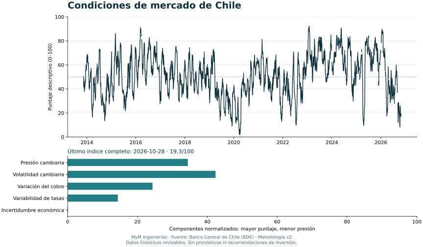
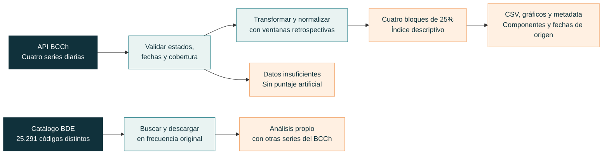

# Índice de condiciones de mercado de Chile

**Una herramienta gratuita de análisis que [MyM Ingenierías](https://mymingenierias.com) pone a disposición del público.**

El dólar, el cobre, las tasas y la incertidumbre económica describen aspectos distintos
del entorno chileno. Este proyecto permite examinarlos en conjunto, consultar sus
componentes y repetir el cálculo con datos del **Banco Central de Chile (BCCh)**.
El código, las transformaciones y los criterios de cobertura están disponibles para
que cualquier persona pueda revisar cómo se obtiene cada resultado.

| Datos | Acceso | Software | Metodología |
|---|---|---|---|
| Exclusivamente API BDE del BCCh | Token personal en `BCCH_API_KEY` | Python 3.11+ · Apache 2.0 | v2.0.0 · Descriptiva y experimental |

[Comenzar](#de-los-datos-al-primer-resultado) · [Metodología](docs/metodologia.md) ·
[Explorar el catálogo](docs/catalogo.md) · [Documentación técnica](docs/referencia.md)

## Una lectura conjunta, con sus componentes a la vista

El indicador resume cuatro bloques con igual peso. Un valor mayor representa condiciones
relativamente más distendidas **según las convenciones y ventanas de esta metodología**.
La escala de 0 a 100 facilita la comparación; no expresa una probabilidad.

| Bloque | Qué observa | Peso |
|---|---|---:|
| Cambiario | Variación del dólar observado y volatilidad de sus retornos | 25% |
| Cobre | Variación del precio del cobre refinado BML | 25% |
| Tasas | Variabilidad de los cambios en la tasa de bonos en pesos a diez años | 25% |
| Incertidumbre | Promedio del índice diario de incertidumbre económica | 25% |

Las medidas se normalizan con percentiles retrospectivos. Cada fecha utiliza sus
observaciones actuales y anteriores; los datos posteriores no entran en ese cálculo.
Si falta historia o cobertura, se informa la ausencia del resultado. Las fechas de
origen se conservan porque las cuatro series no se actualizan necesariamente al mismo tiempo.



*Ejemplo reproducido con corte al 28 de octubre de 2026. Es una figura estática, no un
tablero en vivo. La observación más antigua del último resultado es del 23 de octubre.
[Fuentes, cobertura y sensibilidad del ejemplo](docs/verificacion.md).*

Este indicador **no mide directamente miedo o codicia y no ofrece recomendaciones de
inversión ni pronósticos**. Sus pesos y orientaciones son decisiones de diseño. Una
depreciación puede afectar de manera distinta a un importador y a un exportador;
el puntaje agregado debe leerse junto con sus variables originales.

## De los datos al primer resultado

Se necesita Python 3.11 o superior, Git y acceso habilitado a la
[API del Banco Central](https://si3.bcentral.cl/estadisticas/Principal1/Web_Services/acceso_api.html).

```bash
git clone https://github.com/LautaroParada/Indice-de-miedo-y-codicia.git
cd Indice-de-miedo-y-codicia
python -m venv .venv
```

Activa el entorno con `.\.venv\Scripts\Activate.ps1` en PowerShell o
`source .venv/bin/activate` en macOS/Linux. Luego:

```bash
python -m pip install -e .
```

Copia `.env.example` a `.env` y completa allí `BCCH_API_KEY` con tu token. El archivo
local está excluido de Git; la plantilla no contiene credenciales. También puedes
configurar la variable directamente en el entorno del proceso.

```bash
python indice.py calcular --salida outputs/indice
```

Obtendrás un CSV del índice y sus componentes, las observaciones de las cuatro series,
gráficos SVG/PNG y un archivo de metadata con parámetros, fechas y hashes de los datos.
La [guía de uso](docs/uso.md) explica opciones, errores y ejecución desde Python.



## Un catálogo para ampliar el análisis

El proyecto incluye acceso al catálogo completo mediante
[bcch-sdk](https://github.com/LautaroParada/bcch-sdk): **25.291 códigos distintos en
20 capítulos**, con series diarias, mensuales, trimestrales y anuales. Puedes buscar
por tema, frecuencia, capítulo, fuente y vigencia sin conexión ni token.

```bash
python indice.py catalogo "cobre" --frecuencia diaria
python indice.py catalogo "imacec" --frecuencia mensual
python indice.py catalogo "" --capitulo "Mercado de Capitales" --limite 50
python indice.py serie F032.IMC.IND.Z.Z.EP18.Z.Z.0.M --inicio 2020-01-01 --salida outputs/imacec.csv
```

El catálogo abre otras líneas de trabajo: actividad, inflación, empleo, crédito,
comercio exterior, vivienda, expectativas y estadísticas regionales. Las series
adicionales se descargan en su frecuencia original; no se mezclan automáticamente
con el índice diario. El [mapa del catálogo](docs/catalogo.md) muestra cómo recorrerlo.

## Un proyecto abierto de MyM

El repositorio nació en 2022 como un índice de miedo y codicia chileno. La versión 2
adopta una metodología distinta, basada en series comprobadas en la API actual y
orientada al análisis descriptivo. Conserva la dirección histórica del repositorio,
pero **sus resultados no son una continuación comparable del indicador original**.

MyM Ingenierías mantiene esta herramienta como un recurso público de análisis y
aprendizaje. El desarrollo original corresponde a Lautaro Parada Opazo. El software
se distribuye bajo [Apache 2.0](LICENSE); los datos se atribuyen al Banco Central de
Chile y a las fuentes originales identificadas en su BDE. Es un desarrollo independiente,
sin afiliación ni certificación del BCCh.

| Documento | Contenido |
|---|---|
| [Instalación y uso](docs/uso.md) | Configuración, comandos y archivos de salida |
| [Metodología](docs/metodologia.md) | Series, fórmulas, pesos, fechas y límites |
| [Catálogo BDE](docs/catalogo.md) | Cobertura, filtros y recorridos por tema |
| [Referencia técnica](docs/referencia.md) | Arquitectura, contratos y seguridad |
| [Fundamentos](docs/fundamentos.md) | Literatura y alcance de la evidencia |
| [Verificación](docs/verificacion.md) | Consulta real, pruebas y sensibilidad |

**[MyM Ingenierías](https://mymingenierias.com) · Herramientas abiertas para trabajar con datos.**
