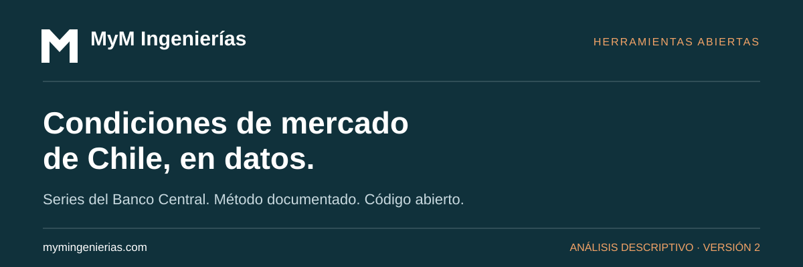
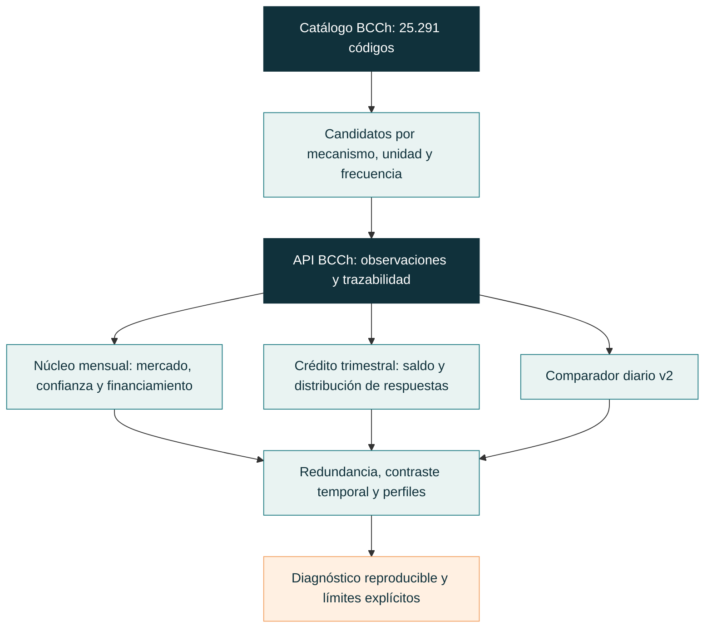

# Miedo, codicia y condiciones financieras de Chile

**Investigación abierta y herramientas gratuitas de [MyM Ingenierías](https://mymingenierias.com), con datos exclusivamente del Banco Central de Chile.**

Una misma cifra agregada puede ocultar mercados que suben mientras cae la confianza,
o bancos que flexibilizan y restringen crédito simultáneamente. Este proyecto estudia
esas diferencias con precios, participación bursátil, encuestas, crédito, liquidez y
posicionamiento. Su propósito es ayudar a entender qué cambió y dónde, con fuentes y
cálculos revisables.

**Estado:** prototipo de investigación. La versión de cuatro fuentes se conserva como
comparador; no se presenta como selección definitiva ni como medición validada de
emociones. La herramienta no ofrece recomendaciones de inversión ni pronósticos.

[Resultados de la segunda investigación](docs/segunda-investigacion.md) ·
[Inventario de 52 candidatos](research/candidates.json) ·
[Metodología de los experimentos](research/protocol.md) ·
[Bibliografía y contribución posible](docs/literatura-ampliada.md)

## Lo que aporta esta revisión

Se censaron los 20 capítulos del catálogo BDE y se seleccionaron candidatos por mecanismo,
unidad, frecuencia y cobertura. **Las 52 series consultadas respondieron correctamente.**
El catálogo completo contiene 25.291 códigos; no todos son pertinentes para sentimiento
financiero y una variante de plazo no constituye automáticamente información nueva.

| Dimensión | Información que permite examinar |
|---|---|
| Mercado | Momentum de acciones y valoración relativa |
| Confianza | Percepción de hogares y empresas, con sus diferencias |
| Participación | Transacciones en relación con capitalización bursátil |
| Financiamiento | Spread bancario, fondeo, crédito real y estándares de aprobación |
| Liquidez y posicionamiento | Composición monetaria y posiciones por contraparte |
| Incertidumbre y expectativas | IDIE, curvas nominales/reales y expectativas declaradas |

La información se conserva en su frecuencia útil: un núcleo mensual amplio, contexto
trimestral de crédito y un comparador diario acotado. No se inventan observaciones
diarias a partir de encuestas mensuales.


*Historia retrospectiva con datos revisables del BCCh. Último mes completo: septiembre
de 2026. Cada perfil tiene una interpretación distinta; alto no significa siempre mejor.*

## Más información, sin contar dos veces lo mismo

La investigación mide redundancia y comprueba su estabilidad temporal. IPSA e IGPA son
casi duplicados en desarrollo; la participación bursátil aporta una lectura mucho menos
correlacionada con mercado y confianza en el periodo posterior. Los resultados completos
incluyen muestras, transformaciones, pares redundantes y pruebas de reconstrucción.


La ortogonalidad matemática no es suficiente: componentes PCA no correlacionados al
ajustarse alcanzan correlaciones de hasta 0,85 después. Por eso el producto conserva
nombres económicos y muestra dependencias, en lugar de prometer factores independientes.

Otro resultado concreto surge de la encuesta de crédito: en 2009-T4 el saldo neto
pyme fue cero con 10,53% de bancos flexibilizando y 10,53% restringiendo. En 2013-T4
también fue cero, pero 100% mantuvo estándares. La
[descomposición de respuestas](docs/credito-distribuciones.md) hace visible esa diferencia.
Es una lectura del dato, no una fórmula nueva ni una predicción de crisis.

## Reproducir la investigación

Requisitos: Python 3.11+, Git y acceso habilitado a la
[API BDE del BCCh](https://si3.bcentral.cl/estadisticas/Principal1/Web_Services/acceso_api.html).

```bash
git clone https://github.com/LautaroParada/Indice-de-miedo-y-codicia.git
cd Indice-de-miedo-y-codicia
python -m venv .venv
```

Activa el entorno con `.\.venv\Scripts\Activate.ps1` en PowerShell o
`source .venv/bin/activate` en macOS/Linux e instala:

```bash
python -m pip install -e .
```

Copia `.env.example` a `.env` y completa allí `BCCH_API_KEY`. La plantilla contiene
la variable vacía; el archivo local está excluido de Git. El entorno del proceso tiene
prioridad. Nunca pegues el token en comandos, notebooks o incidencias.

```bash
python -m research.collect
python -m research.analyze
python -m research.figures
```

La consulta predeterminada reproduce el corte fijo 2026-10-28. Los datos y resultados
quedan en `outputs/research/`: manifest con hashes, series, variables transformadas,
correlaciones por periodo, panel mensual y distribuciones trimestrales. Las figuras se
generan en `docs/assets/`. El análisis verifica los hashes del snapshot antes de usarlo.



## Explorar otras preguntas con la BDE

```bash
python indice.py catalogo "confianza" --frecuencia mensual
python indice.py catalogo "" --capitulo "Derivados" --limite 50
python indice.py serie F032.IMC.IND.Z.Z.EP18.Z.Z.0.M --salida outputs/imacec.csv
python indice.py calcular --salida outputs/baseline-v2
```

`calcular` ejecuta el comparador diario v2. No incorpora automáticamente todos los
candidatos de investigación. La [guía de uso](docs/uso.md) y el
[mapa del catálogo](docs/catalogo.md) documentan las opciones.

## Evidencia y límites

Hay evidencia de información omitida y de diagnósticos que un promedio oculta. Aún
faltan validación prospectiva, comparación con indicadores existentes, sensibilidad
completa y evaluación de utilidad con usuarios. La historia disponible contiene revisiones
y no reconstruye cuándo se publicó cada observación. No se afirma novedad científica
demostrada, causalidad, capacidad predictiva ni superioridad sobre el indicador original.

| Documento | Contenido |
|---|---|
| [Segunda investigación](docs/segunda-investigacion.md) | Hallazgos, cifras, interpretación y trabajo pendiente |
| [Auditoría del catálogo](docs/auditoria-catalogo.md) | Los 20 capítulos y selección por mecanismos |
| [Literatura ampliada](docs/literatura-ampliada.md) | Antecedentes y posibles contribuciones falsables |
| [Crédito y distribuciones](docs/credito-distribuciones.md) | Cancelaciones que oculta el saldo neto |
| [Protocolo reproducible](research/protocol.md) | Hipótesis, particiones y reglas de análisis |
| [Uso](docs/uso.md) · [Referencia técnica](docs/referencia.md) | Configuración, API y seguridad |
| [Metodología v2](docs/metodologia.md) · [Verificación v2](docs/verificacion.md) | Comparador conservado para contrastar la ampliación |

Desarrollo original: Lautaro Parada Opazo. Proyecto abierto de MyM Ingenierías bajo
[Apache 2.0](LICENSE). Datos atribuidos al BCCh y a las fuentes identificadas en su BDE.
Desarrollo independiente, sin afiliación ni certificación del Banco Central.
