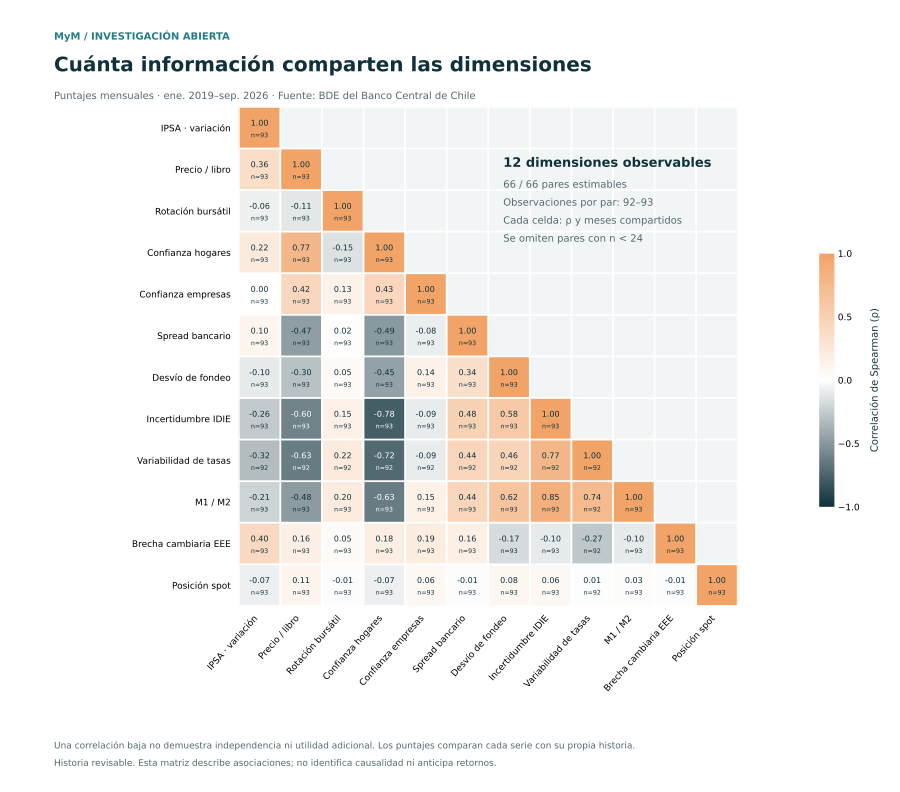
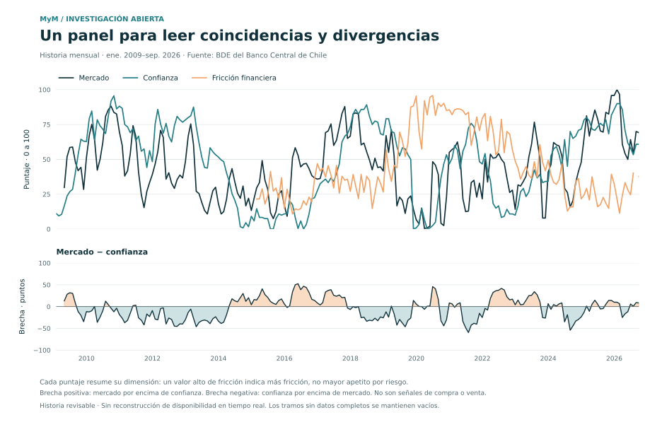

# Segunda investigación: recuperar mecanismos y comprobar información adicional

**29 de octubre de 2026. Estado: prototipo experimental reproducible; no metodología final validada.**

## Qué estuvo mal en la selección anterior

No hubo evidencia de que cuatro fuentes fueran suficientes. Se priorizó disponibilidad
diaria y simplicidad sin comparar el universo de candidatos. La falta de respuesta de
los códigos originales de IPSA diario y EMBI no justificaba excluir mecanismos bursátiles,
de crédito o de expectativas, ni demuestra su retiro permanente.

El diseño original del blog tenía cuatro fuentes brutas y cinco medidas: dólar/IPSA,
EMBI, momentum IPSA, volatilidad IPSA e incertidumbre. Cubría mecanismos que la v2 perdió.
También concentraba 69% del peso en medidas relacionadas con IPSA. Tener mecanismos
distintos era una motivación razonable; su ortogonalidad estadística no estaba demostrada.
Las correcciones de software de v2 se conservan, pero su selección económica se trata
ahora como **baseline**, no como solución final para promocionar.

## Qué se hizo ahora

Se censaron los **20 capítulos, 30.920 contextos y 25.291 códigos** del catálogo y se
buscaron familias pertinentes por mecanismo. No se revisaron individualmente las
25.291 metodologías ni se descargó indiscriminadamente toda la BDE. De esa revisión
resultaron **52 códigos candidatos**, todos con respuesta válida de la API al consultar
2006-01-01 a 2026-10-28. El inventario incluye códigos, unidades, frecuencia, fuente,
transformación y razón conceptual: [candidates.json](../research/candidates.json).

El procesamiento produce 51 variables mensuales, incluidas transformaciones e insumos
de contexto, y 11 series trimestrales —seis saldos ECB y cinco categorías de respuesta—.
**Estos recuentos no son 62 factores independientes ni votos para un promedio.** Las
series recientes de derivados no tienen historia suficiente para el ajuste hasta 2018.

| Familia | Información recuperada | Tratamiento |
|---|---|---|
| Bolsa | IPSA, IGPA, valoración bolsa/libro, transacciones y capitalización | Momentum mensual y turnover; IGPA como alternativa, no duplicación |
| Confianza | Hogares, empresas, empresas sin minería e intención de inversión | Comparar agentes; no equipararlos a inversionistas bursátiles |
| Crédito | Spread bancario, crédito real, mora, oferta y demanda declaradas | Distinguir precio, cantidad, acceso y demanda |
| Fondeo y liquidez | Interbancaria/TPM y composición M1/M2 | Diferenciales y ratios; evitar niveles nominales como sentimiento |
| Curvas y expectativas | Bonos nominales/reales, pendientes, EEE | Plazos comparables; medianas no son dispersión |
| Posicionamiento | Spot, derivados y contrapartes institucionales | Contexto; no atribuir cobertura a especulación |
| Incertidumbre y entorno | IDIE, cobre, tipo de cambio e Imacec | Conservar contexto y distinguirlo de disposición a asumir riesgo |

La [auditoría del catálogo](auditoria-catalogo.md) explica la cobertura y exclusiones.
La fuente de datos sigue siendo exclusivamente el BCCh, aunque la BDE atribuya algunas
series a encuestadoras o bolsas. No se consulta directamente a esos proveedores.

## Resultado 1: algunas variables sí duplican información

Spearman de transformaciones normalizadas en el periodo de desarrollo hasta 2018:

| Pareja | Correlación | Meses comunes |
|---|---:|---:|
| Momentum IPSA / IGPA | 0,992 | 117 |
| Interbancaria / TPM | 0,990 | 120 |
| IMCE total / sin minería | 0,971 | 120 |
| IPEC / expectativa país a 12 meses | 0,891 | 120 |

Esto justifica conservar alternativas y construir diferenciales, en lugar de sumar
totales y componentes. Hay otros pares relacionados: por ejemplo bolsa/libro y
confianza empresarial sin minería alcanzan 0,897 en desarrollo. Por ello tampoco se
declaran ortogonales los bloques nuevos. La matriz posterior permite examinar cambios.



## Resultado 2: el conjunto nuevo contiene más dimensiones, con límites

Se compararon 12 factores de mecanismos identificados con los cinco factores v2 sobre
las **mismas fechas completas**: 47 meses de desarrollo y 92 de contraste desde 2019.
La dimensión efectiva se calcula como `(tr(C))²/tr(C²)`, con `C` de Spearman.

| Conjunto | Desarrollo | Contraste posterior |
|---|---:|---:|
| Cinco factores v2 | 4,00 | 3,53 |
| Doce factores candidatos | 5,40 | 4,83 |

La ampliación contiene más diversidad estadística bajo esta medida. No equivale a
12 dimensiones independientes ni prueba mayor utilidad económica. La muestra de
desarrollo es pequeña y este diagnóstico es exploratorio, sin intervalo de confianza.

PCA deja correlación prácticamente cero entre componentes en desarrollo, pero la
correlación máxima absoluta llega a **0,852** después. Se requieren nueve componentes
para explicar 95% de la varianza de desarrollo. Esta prueba muestra por qué fabricar
ortogonalidad dentro de una muestra no resuelve la interpretabilidad ni la estabilidad.

Una reconstrucción ridge fija, ajustada solo hasta 2018 con los cinco factores v2,
obtiene R² posterior de −0,043 para IPSA, −0,130 para turnover, −0,019 para IPEC y
0,139 para bolsa/libro. Son malos resultados de reconstrucción de variables
contemporáneas, **no resultados de un modelo que pronostique retornos**. Ese predictor
no reconstruye bien esas variables en el contraste posterior; esto no demuestra que toda información residual
sea señal útil en vez de ruido, cambio de régimen o transformación distinta.

## Resultado 3: separar perfiles evita cancelaciones

El prototipo mensual muestra seis lecturas, sin sumarlas todas en un número:

| Lectura | Construcción experimental | Lectura de un valor alto |
|---|---|---|
| Mercado | Media de rangos IPSA 3m y bolsa/libro | Mayor momentum/valoración relativos |
| Confianza | Media de rangos IPEC e IMCE sin minería | Mayor confianza declarada relativa |
| Fricción | Media de rangos spread bancario, desviación interbancaria/TPM, variabilidad de tasas e IDIE | Mayores presiones según estas convenciones |
| Participación | Rango de transacciones/capitalización | Mayor rotación; su dirección económica es ambigua |
| Crédito real | Rango del crecimiento anual de colocaciones deflactadas por IPC | Mayor expansión relativa de crédito |
| Composición líquida | Rango de M1/M2 | Mayor cuota líquida; no identifica por sí sola miedo |

Las medias requieren todos sus componentes, sin reponderar ausentes. Se exige al menos
diez cambios diarios observados para la variabilidad mensual de tasas. El uso de la
desviación absoluta interbancaria/TPM es una convención de funcionamiento del fondeo;
desviaciones negativas y positivas no tienen idéntica interpretación económica.



Entre 2019 y septiembre de 2026, participación/mercado correlacionan −0,102 y
participación/confianza −0,005. Mercado/confianza, en cambio, correlacionan 0,547.
La participación ofrece una lectura poco redundante en esta muestra; aún debe
demostrar utilidad para una tarea de usuario. No se denomina «codicia» a volumen alto.

## Resultado 4: el mismo saldo crediticio puede esconder situaciones distintas

Se verificó la convención oficial ECB: oferta positiva significa flexibilización
neta. Las cinco proporciones suman 100% dentro de tolerancia de 0,5 puntos y reproducen
el saldo publicado en los 83 trimestres disponibles. Cada banco responde con igual peso.

| Periodo | Flexibilizan | Restringen | Sin cambios | Saldo neto | Coexistencia de direcciones |
|---|---:|---:|---:|---:|---:|
| 2009-T4 | 10,53% | 10,53% | 78,95% | 0 | 21,05 puntos |
| 2013-T4 | 0% | 0% | 100% | 0 | 0 puntos |

La coexistencia es `2 × mínimo(%flexibilizan, %restringen)`. Es una descomposición
algebraica, no una invención matemática ni una variable ortogonal al saldo y amplitud.
Su utilidad concreta es hacer visible algo que la cifra neta oculta. No demuestra
incertidumbre de cada banco ni que un trimestre anticipe una crisis.
[Definiciones, códigos y fuentes oficiales](credito-distribuciones.md).

## Qué propuesta merece seguir

Un **mapa de apetito observado, confianza y fricciones**, acompañado de participación,
crédito y heterogeneidad de respuestas. La actualización mensual reúne información que
la restricción diaria descartaba; la v2 diaria queda como comparación parcial y las
encuestas de crédito permanecen trimestrales. No se fabrican observaciones mensuales
repitiendo un dato trimestral.

La contribución investigable es mostrar **desacoples y cancelaciones entre mecanismos**
con trazabilidad y bajo costo de lectura. Sumar más series, usar PCA o cambiar de marca
no constituye novedad. Tampoco se afirma haber demostrado una medición directa de miedo
y codicia. El ICF chileno del DT905 y los shocks del DT1080 son antecedentes obligatorios.
[Revisión bibliográfica y referencias APA](literatura-ampliada.md).

## Reproducir y evaluar

```bash
python -m research.collect
python -m research.analyze
python -m research.figures
python -m pytest
```

El colector usa `BCCH_API_KEY` del entorno o de `.env`; acepta `--env-file` para un
archivo local alternativo. `.env.example` declara la variable sin valor. Los datos crudos y resultados de
ejecución se guardan en `outputs/research/`, excluido de Git. Los CSV se verifican por
hash y estado del manifest antes de analizarlos; un CSV antiguo de una consulta fallida
no se reutiliza silenciosamente. Las fechas se tratan como periodos de observación.

La normalización compara cada mes con los 60 anteriores, mínimo 36, excluyendo el
mes actual de la referencia. Se descarta octubre de 2026 por no haber concluido al
corte. Diarios pasan a medias mensuales; los mensuales conservan su valor observado.
Consulta el [protocolo](../research/protocol.md), las [métricas completas](assets/research-summary.json)
y el [manifest sin credenciales](assets/research-manifest.json).

La verificación local comprende 47 pruebas automatizadas, incluidas 16 para esta
ampliación, Ruff y construcción de wheel y sdist. Se comprobaron las exclusiones de
secretos y la ausencia del token real en los archivos preparados para el commit.
Las consultas reales de los 52 códigos se registran en el manifest; las pruebas
automatizadas usan datos sintéticos y no necesitan credenciales.

Para una herramienta estable y un paper faltan: revisión sistemática de novedad,
calendarios de publicación y vintages, sensibilidad a ventanas/pesos/rezagos, criterios
de selección congelados, comparación con ICF y original parcial, evaluación prospectiva
y tareas con usuarios que midan comprensión y tiempo. No se reconstruyó el índice
original completo porque faltan sus dos fuentes diarias. El contraste posterior a 2018
es retrospectivo y no un holdout prístino. Esta entrega establece evidencia y código
para continuar esa validación; no la declara concluida.
